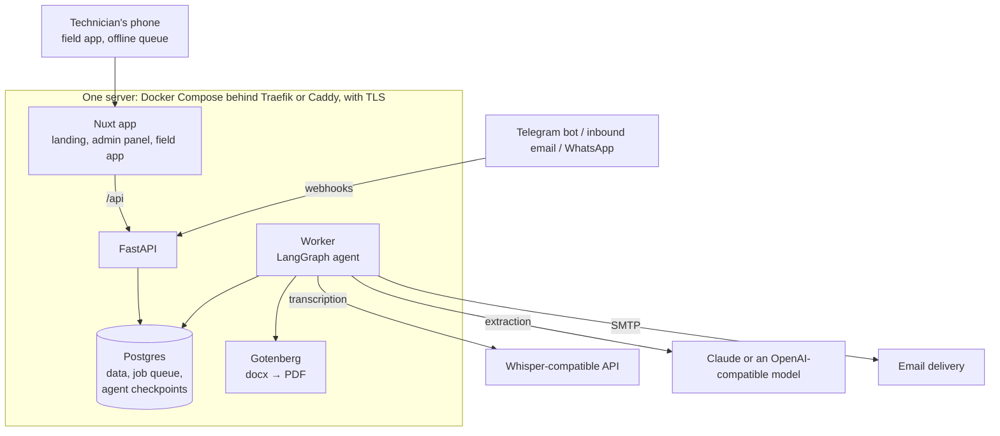
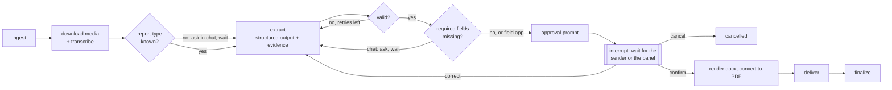

# ReportAI — Development Roadmap

## 1. Overview

ReportAI turns a field technician's voice note (or typed notes and photos) into a finished report
in the company's own Word template, sent as a PDF once the technician has confirmed what was
extracted. Its audience is occupational health and safety (PRL) work: coordinators and
technicians who visit sites, inspect and have to leave a written record.

One codebase runs in two modes:
- **Hosted, multi-tenant** (`SINGLE_TENANT=false`): companies share one service and the super
  admin creates them. Self-signup exists behind `SIGNUP_ENABLED`, which is off.
- **Self-host** (`SINGLE_TENANT=true`): one company per server, installed with
  `infra/install/install.sh` and set up in the panel's wizard (`docs/install.md`).

ReportAI is not on sale (2026-11-11, §8). The hosted service is a showcase with a live demo;
whoever wants to try it gets an account with sample data, or installs it on their own server.

This file is the working tracker (what is built, what is next and why), not a presentation. The
presentation is the engineering case study served at `/architecture`.

## 2. Architecture

- The API never runs the agent: it stores the input and enqueues a job
  (`backend/app/services/jobs/`). The worker claims jobs with `FOR UPDATE SKIP LOCKED`, holds a
  lease with a heartbeat and retries with backoff; a retry resumes the graph from its last
  checkpoint.
- The panel and the API share one domain, the API under `/api`: no CORS in production.

### Agent pipeline (LangGraph, `backend/app/services/agent/graph.py`)

Every pause is a LangGraph `interrupt()` saved by the Postgres checkpointer, so a report can wait
days for its confirmation. In the field app the form is the question: missing fields are
highlighted instead of asked in chat, and confirming goes through the same `approve` endpoint as
the panel, which refuses while a required field is empty.

### Channels

Every way in implements `ChannelAdapter` (`backend/app/services/channels/base.py`,
`docs/channel-adapter.md`): `web` (the field app, the primary channel), `telegram` (the company's
own bot, by webhook or by long polling when there is no public domain), `email` (inbound through
Mailgun) and `whatsapp` (experimental).

### Stack summary

- **Backend:** Python, FastAPI, SQLAlchemy 2 (async), Alembic, Postgres 16
- **Agent:** LangGraph with `langgraph-checkpoint-postgres`
- **AI:** Anthropic Claude (structured outputs) or any OpenAI-compatible endpoint; transcription
  through any Whisper-compatible API (Groq by default). Entered in the panel, encrypted at rest
- **Rendering:** docxtpl into the company's `.docx`, Gotenberg for the PDF
- **Frontend:** Nuxt 4, Vue 3, Vuetify 4, Pinia, `@nuxtjs/i18n` (es/en), a hand-written service
  worker for the field app
- **Infra:** Docker Compose; Traefik on the hosted service, Caddy in the self-host installer;
  GitHub Actions for CI, images on GHCR and releases on `v*` tags
- **Observability:** an execution log per AI call (tokens, audio seconds, cost, latency), an
  audit log, optional Sentry
- **Testing:** pytest against a real Postgres, the tenant-isolation matrix, the golden-set eval
  (`pytest -m eval`, real API calls), frontend unit tests and a smoke test of the built server's
  security headers

## 3. Architecture & scope decisions

| Decision | Rationale |
|---|---|
| Fully custom-coded agent (no low-code/workflow-builder tools) | A project living entirely in a no-code tool structurally closes the signal channel hiring managers look for: readable commit history, testable/inspectable architecture, real version control. |
| Multi-tenant from the data model up, with a client-facing admin panel | Each company configures its own report types, templates, people and recipients itself, not through a support ticket. |
| One codebase for the hosted service and self-host; self-host must not change | Two products would double the maintenance. New flags default to off and new columns get neutral defaults, so a `SINGLE_TENANT=true` install behaves as before. |
| Not on sale: the hosted service is a showcase, self-host is for whoever wants to run it | See the 2026-11-11 log entry. The code stays SaaS-ready, with self-signup behind its flag. |
| Field app (installable web app) as the primary channel; chat channels as optional connectors | No dependence on Meta or Telegram for the core flow, review in a form instead of a chat, no third-party platform holding the voice notes, and sign-up without installing anything. |
| Human confirmation before anything is sent | No agent sends on a company's behalf without an explicit checkpoint: a LangGraph interrupt that the sender or the panel resumes. |
| Structured LLM output (structured outputs / forced function call), never raw JSON in a prompt | Removes an entire class of parsing failures; every value comes with the quote it was taken from. |
| Report type and field schema as per-company runtime config (a Pydantic model built from the database) | A new company or report type is configuration, not a code change. |
| Postgres as the job queue (`SKIP LOCKED`, lease and heartbeat), no Redis or Celery | One fewer service to run and back up; at this volume Postgres is enough. Trigger to revisit: sustained queue latency or several worker hosts. |
| Tenant isolation enforced in code (`core/scoping.py`) and proven by a test matrix; Postgres RLS deferred | Another company's row is a 404, never a 403. RLS comes with the first enterprise client or an audit that asks for it. |
| Self-hosted Postgres, not a managed backend-as-a-service | Long-lived, multi-tenant product: warrants owning the infra. |
| Own document rendering: docxtpl (Jinja2-tagged .docx templates) → self-hosted Gotenberg | No opaque dependency, no third-party API receiving confidential documents. |
| Golden-set eval suite + structured cost/latency logging from the first commit | Highest-leverage investment for both reliability and demonstrable engineering quality. |
| Secrets in environment variables or encrypted in the database, never committed | Non-negotiable baseline for a multi-tenant system handling company documents. |
| Public repository with sanitized/synthetic data only | No real company content ever appears in this repo, in eval datasets or in the public demo. |
| Real incremental commit history from day one | A single big-bang commit or a squashed import reads as a red flag; history must reflect actual development. |

## 4. Data model overview

Every company-owned table carries `tenant_id` and is read through `get_scoped_or_404`.

- `tenants` — one company: language, time zone, branding, plan and trial, pending deletion
- `tenant_users` — panel and field-app accounts with their role (super admin, admin, approver,
  viewer, technician) and the token version that ends every session at once
- `password_reset_tokens`, `used_refresh_tokens`, `sender_invites` — single-use links and
  refresh-token rotation; invitations for chat senders
- `channel_connections` — the company's ways in (field app, Telegram bot, inbound email,
  WhatsApp), credentials encrypted, allowed senders
- `inbound_messages` — one row per external message id: what makes ingestion idempotent
- `document_types`, `document_templates` — report types with their field schema and recipients,
  and the `.docx` template behind each
- `reports`, `report_revisions`, `report_attachments` — the report (status, transcript, fields,
  evidence, files), every edit to it, and its photos
- `deliveries` — one row per copy sent, with its state, for resending
- `jobs` — the work queue the worker drains
- `execution_logs` — one row per AI call: tokens, audio seconds, cost, latency
- `audit_events` — who did what in the panel
- `rate_limit_hits` — the Postgres-backed rate limiter
- `instance_settings` — the installation's own settings entered in the panel (AI provider, mail
  server), secrets encrypted
- LangGraph's checkpoint tables — the paused state of every report waiting for an answer

## 5. Development phases

The repository went through three numberings of phases (the first plan in August, the audit of
2026-09-30 and the SaaS plan of 2026-11-06). Here they are listed by date, with their pull
requests.

### Shipped

| When | What | PRs, tags |
|---|---|---|
| 2026-08-10 → 08-17 | Foundations; agent core with Telegram, WhatsApp and inbound email, human approval and the first golden set; admin panel; demo mode; bilingual landing with a real pre-generated example | #1–#11 |
| 2026-09-30 → 10-02 | After a full audit: installable, secure production and licence; reliable reports (Postgres job queue and worker, deliveries, conversation in chat, extraction with evidence, report detail and history, golden-set gate); self-install (installer, setup wizard, encrypted settings, single-tenant mode, updates); PRL landing | #12–#19, v0.3.0, v0.4.0 |
| 2026-10-19 | Landing for engineers with the architecture page | #20 |
| 2026-11-07 | SaaS foundations: tenant-isolation matrix, plans and quotas, Postgres rate limiter, audit log, usage metering, technician role with magic link, data export and deletion, error reporting, self-signup (off) | #21 |
| 2026-11-08 | Field app: capture, offline queue, installable, starts without coverage, CSP with a per-response nonce | #22 |
| 2026-11-10 | PRL landing, public live demo with its own limits, engineering case study | #23, #24 |
| 2026-11-11 | Not on sale: landing without prices, privacy policy, live-demo setup script | #25 |
| 2026-11-17 | v0.5.0: README and roadmap matching the product, release candidates as prereleases, the installer verified end to end (fresh install, and update from 0.4.0), optional worker heartbeat; company AI keys on the hosted service (closed provider list, the spend breaker counts only what the platform pays; self-host unchanged) | #26–#29, v0.5.0 |
| 2026-11-18 | v1.0.0: MCP server for AI assistants on reports, with personal API keys and the AI assistants page; an eval of an assistant using it; the installer's update from 0.5.0 verified end to end (data intact, a real MCP client with a real key) | #30, v1.0.0 |
| 2026-11-25 | v1.1.0: after an outside review — the report search matches field values only; OAuth 2.1 sign-in for AI assistants (claude.ai connected end to end), the report PDF through the MCP server, expiring API keys; the main flow tested in a browser in CI; the paid eval runs published; writes committed before the response is sent | #33–#40, v1.1.0 |

### Next: the finish line is v1.0.0

- [x] **v0.5.0** — README and this roadmap match the product; the installer verified end to end
  (fresh install, and update from 0.4.0); release.
- [x] **Company AI keys** — on the hosted service each company enters its own AI provider and key
  when it sets the service up, from a closed list of providers; the platform's key serves only
  companies the super admin marks (the live demo), and the spend breaker counts only what the
  platform pays. Self-host unchanged.
- [x] **Uptime monitor** on the hosted service: the panel and `/api/health` from outside (UptimeRobot,
  every 5 minutes; `/api/health` alerts when `"status":"ok"` is missing), and the worker's heartbeat
  (healthchecks.io, a ping every minute, 5 minutes' grace).
- [x] **Agent and MCP, on reports** — a remote MCP server over Streamable HTTP (`/api/mcp`)
  whose tools go through the panel's own checks: list the document types, search and read reports,
  hand over a finished report's PDF, and start a draft that a person reviews (never approve or
  send). Assistants sign in with OAuth 2.1 (consent in the panel) or a personal API key (hashed,
  revocable, expiring after 30, 90 or 365 days or never); either acts as its person and their
  role, managed in the panel; an eval of an assistant
  using it (tool choice, prompt injection, isolation). Left out: an assistant inside the app, a
  proactive weekly summary, outgoing webhooks.
- [x] **v1.0.0** — released 2026-11-18; maintained on demand from here: new work only on the triggers below and in §6.
- [x] **v1.1.0** — released 2026-11-25, after an outside review of v1.0.0 (see the decisions log of that day).

### Deferred, with the trigger that brings each back

- **Operations layer** (sites, findings, corrective actions, visit schedules): excluded on
  2026-11-10; back if users of the reports ask for the follow-up.
- **Billing and plans with a payment provider:** out since 2026-11-11 (not on sale).
- **Client portal and signature:** when someone wants to use ReportAI with real company data.
- **Dedicated server, off-site backups and a restore drill for the hosted service:** before the
  first company with real data.
- **A public REST API with the same personal keys:** the keys serve only the MCP server, and the
  API's own docs stay off in production; back when someone needs to integrate ReportAI without an
  AI assistant.
- **Required columns in a table field** (a finding approved without its corrective measure or
  deadline): only top-level fields are required today; back with the first pilot whose reports need
  it, as part of the operations layer.
- **Completing a draft's missing fields from an AI assistant:** the MCP server starts drafts but
  can't fill in what the extraction left empty, so the person goes to the panel; back when a user
  asks for it, keeping approval in the panel (a tool limited to a pending draft's empty fields).
- **Slack and Microsoft Teams adapters:** only for a specific client that asks (see the
  2026-08-10 log entries for why Teams needs that client's IT admin).

## 6. Explicitly out of scope for now

- WhatsApp on the hosted service: if two or more users ask for it.
- Postgres row-level security: with the first enterprise client or an audit that requires it.
- Object storage (S3): when there is a second application server.
- A native app wrapper: only if recording on an iPhone stops with the screen locked and users
  suffer it.
- A shared Telegram bot for the platform: the field app takes its place.
- Live transcription while speaking: the note is transcribed when the recording stops.
- SSO: with the first client that requires it.

## 7. Known risks

- Real company data must never enter the public repo, eval datasets or the demo: synthetic data
  only, checked before every public push.
- Recording with the screen locked is verified on Android only; iPhone is untested.
- The hosted service shares a server and keeps its backups on it: acceptable only while it holds
  demo and sample data (see "Deferred").
- The live demo records visitors' voices: covered by the privacy policy, its own daily limits and
  a 24-hour purge.
- Extraction quality depends on the configured model: Claude and OpenAI have passed the golden
  set; any other model is unvalidated.
- Scope discipline: no new feature without a trigger from a real user (see §5 and §6).

## 8. Decisions log

| Date | Decision | Owner |
|---|---|---|
| 2026-08-10 | Project is fully custom-coded and independent | Confirmed |
| 2026-08-10 | Business path: white-label deployments via existing consulting relationships, not public self-serve SaaS (yet) | Confirmed |
| 2026-08-10 | Repository will be public, with sanitized/synthetic data | Confirmed |
| 2026-08-10 | Multi-tenant admin panel is in scope for the initial build, not deferred | Confirmed |
| 2026-08-10 | Microsoft Teams cannot be reached via MCP — MCP lets an agent call ReportAI as a tool, it is not a message-transport channel. Teams ingestion requires Azure Bot Service + Entra ID app registration + Teams app manifest, approved per-tenant by the client's IT admin (Microsoft disallowed new multi-tenant bots as of 2025-07-31) | Confirmed (Microsoft Learn) |
| 2026-08-10 | Channel priority reordered: Telegram + WhatsApp Business Cloud API + Email-in for the initial build — the channels the target audience (non-technical SME field reps, Spain/LatAm) actually uses with zero IT gatekeeping. Slack and Microsoft Teams moved to on-demand, per-client build (Phase 3). Discord, Google Chat, SMS, and RCS evaluated and not prioritized. | Recommended — open for override |
| 2026-08-10 | Frontend (Nuxt/Vuetify/Tailwind) scaffold deferred to the start of Phase 2 — Phase 0 ships backend + infra only, so three fast-moving frontend libraries don't sit installed and unused through all of Phase 1 | Confirmed |
| 2026-08-10 | Document rendering: docxtpl + self-hosted Gotenberg | Confirmed |
| 2026-08-11 | FastAPI `BackgroundTasks` for Phase 1's async pipeline execution, not Celery/arq | Confirmed — upgrade trigger: multiple backend instances, or need for durable retry of a crashed in-flight run |
| 2026-08-11 | LangGraph's Postgres checkpointer is the durability mechanism for the human-approval pause/resume, not the task runner | Confirmed |
| 2026-08-11 | `notification_emails` added as an `ARRAY(String)` column on `document_types` | Confirmed — the Phase 0 schema had no place to store report recipients |
| 2026-08-11 | Public landing page (previously Phase 5) and minimal real auth (first item of Phase 2 — JWT login against `tenant_users`, protected placeholder dashboard) built now, ahead of their original order. The rest of the admin panel (tenant management, template management, channel management, recipients, report history, usage dashboard) remains pending in Phase 2. No brand investment (no logo); the landing deliberately avoids generic AI-look defaults (cream+serif, black+neon, broadsheet+hairlines) with a token system anchored in the product's real mechanism. | Confirmed |
| 2026-08-11 | Phase 2 completed end-to-end: password recovery (DB-backed single-use reset/invite tokens, reused for both forgot-password and tenant-admin invites), super-admin tenant management, tenant-admin document type/field-schema/template management (`.docx` upload validated against the Jinja tags it actually contains), channel connection management with a per-tenant sender allow-list enforced once in the pipeline's single entry point, report history with download, and a usage/cost dashboard shared between the tenant-admin view and a super-admin per-tenant drill-in. Migrations `0003`–`0006`. Every tenant-scoped endpoint resolves `tenant_id` from the authenticated user, never from client input; cross-tenant access renders as 404. Fixed two pre-existing defects found while building this: a JWT `type`-claim check missing from `get_current_user` (a refresh token could authenticate like an access token), and a `useCookie`/`nextTick` race in the login flow that could send `/auth/me` before the session cookie was written. | Confirmed |
| 2026-08-13 | Fixed a CI regression from the Phase 2 merge: `DOCUMENT_STORAGE_PATH` defaulted to `/app/storage`, a Docker-only path, which broke 4 tests on the bare GitHub Actions runner. Default changed to a relative `storage`, which still resolves to `/app/storage` in Docker (WORKDIR is `/app`) and to `backend/storage` in CI — zero behavior change in Docker/prod, no other files needed changing. | Confirmed |
| 2026-08-13 | Reaffirmed the 2026-08-11 no-logo / no-brand-investment decision after review: the current design system (typographic wordmark, a 7-token color palette + Space Grotesk/IBM Plex type mirrored between Tailwind config and the Vuetify theme, used consistently across the landing page, auth flow, and all seven admin/dashboard pages) is complete and reads as professional as-is. Revisit only if a paying client asks for brand collateral. | Confirmed |
| 2026-08-13 | Public demo domain: a free `is-a.dev` subdomain (`reportai.is-a.dev`) with an A record to the private server, chosen over `eu.org` (manual review takes days to weeks, plus mandatory annual reconfirmation) and Freenom (discontinued 2023). Revisit a paid domain once real traction or a real client justifies it. | Confirmed |
| 2026-08-13 | Found via a real end-to-end run (not a unit test): `human_approval_prompt_node` sends the approval request on the origin channel with no try/except — if that send fails (seen here as a 404 from the demo's fake Telegram token), the exception kills the whole report before it ever reaches the `await_human_approval` interrupt, discarding an already-completed, already-paid-for extraction. Deferred: a real bot token essentially never 404s this way, and the correct fix (should a send failure still let the graph reach the interrupt so approval remains possible from the admin panel?) is a real design call, not a one-line patch. Revisit if this is ever hit with a live channel token in production. | Confirmed — deferred |
| 2026-08-15 | "Finish the project" scope confirmed: Phase 4 + public-demo hardening only; Phases 3 and 5 remain deferred with their existing triggers | Confirmed |
| 2026-08-15 | Public demo is fully interactive: a real Telegram bot open to anyone plus one-click demo login to the panel, protected by a per-sender rate limit, a global daily spend cap (computed from `execution_logs.cost_usd`), and an audio duration limit — not a read-only showcase | Confirmed |
| 2026-08-15 | Deployment target: the existing VPS already running the shared Traefik + Let's Encrypt stack — no new server provisioning | Confirmed |
| 2026-08-15 | Single-domain prod routing: `reportai.is-a.dev` serves both the Nuxt frontend and, under the `/api` path prefix (Traefik StripPrefix), the FastAPI backend — removes prod CORS and any dependency on nested is-a.dev subdomains | Confirmed |
| 2026-08-15 | The 2026-08-13 deferred approval-prompt finding's revisit trigger is met (a public demo is a live channel) — fix scheduled in Phase 4.A | Confirmed |
| 2026-08-15 | Phase 4 exploration found the resume branch was dead code: nothing ever wrote `reports.status = "awaiting_approval"` / `"awaiting_doctype_selection"` (and the column was `String(20)`, too narrow for the latter), so a CONFIRM reply started a new run with a new extraction instead of resuming, and the paused run stayed orphaned in the checkpointer. Fix: migration `0007` widens the column; `_run_graph`/`_resume_graph` mark the pause status after `ainvoke` returns with `__interrupt__` (single choke point, correct for re-interrupts after corrections); resumes go through an atomic `claim_for_resume` (`UPDATE … WHERE status IN pending`) so duplicate replies can't double-resume one thread; both prompt sends are now best-effort try/except; new `POST /reports/{id}/approve` and `/reject` panel endpoints. Covered by tests that do NOT hand-insert the status (the old test's blind spot). | Confirmed |
| 2026-08-15 | **Supersedes the entry above ("Public demo is fully interactive")**: opening a Telegram bot to anonymous internet traffic and deploying to the VPS is deferred until a real paying client needs it — the whole system (bot config, webhook security, abuse guards, demo login, read-only panel) stays built and ready, just not activated. The public-facing demo instead lives inside the landing page itself: a real, complete example (voice note → real Groq transcription → real Claude extraction → real docxtpl+Gotenberg PDF) generated once via `backend/scripts/generate_landing_demo_asset.py` and served as static assets (`frontend/public/demo/`), not a live call from anonymous web traffic — avoids reopening the exact abuse/cost surface the Phase 4.A guards exist to close, while still proving the product works with genuine, unedited output. Rationale + full narration script are in the (now-superseded) planning session; the audio was generated via Higgsfield TTS (`seed_audio`, voice "Dylan") — the script was shortened from the original draft to fit available Higgsfield credits (dropped the payment-terms tangent, kept both action items and the core agreement). | Confirmed |
| 2026-08-15 | Found via the landing demo generation run: when the source text never mentions a date, Claude still fills the required `meeting_date` field rather than leaving it empty — it returned `2024-01-01` for the real example (a clearly wrong date, kept **unedited** in the landing per an explicit decision to preserve 100% real, unedited pipeline output over a polished-looking date). This is a real extraction-schema gap, not a demo artifact: a required field with no source value should probably default to the message's received date, or the field should be optional with a fallback — not fabricated silently. Not fixed here (out of scope for the landing work); revisit when doing any further extraction-quality work. | Confirmed — deferred |
| 2026-08-15 | Landing page reworked after live review: (1) demo-login access removed from the landing UI entirely — Hero and FinalCta collapse to one CTA, a `mailto:adrian@vazquezdev.pro` contact link; the backend (`POST /auth/demo-login`, read-only guard) stays built but with no UI entry point, same "ready, not activated" pattern as the Telegram bot. (2) Full visual pass (`/landing-page-motion` + `frontend-design`): confident type scale, a recurring "template placeholder resolving" signature motif (used twice — hero open, final CTA close, not scattered), section-specific GSAP choreography instead of the same fade everywhere, alternating light/dark rhythm, all CSS/type/motion — no new Higgsfield spend. Found and fixed along the way: white-on-`capture-500` (the CTA button color) is 2.84:1, failing WCAG even for large text — added `capture-600` (#C0432A) as a text/button-safe darker step of the same hue. | Confirmed |
| 2026-08-15 | Landing demo example redone a second time: (1) **real bug fixed** — `RealDemoSection.vue`'s transcript reveal never fired on play; `onPlay()` flipped the `v-if`/`v-else` that mounts the transcript spans and called the GSAP reveal in the same synchronous tick, before Vue's next-tick re-render created those elements, so `gsap.fromTo` animated an empty ref array and the static `opacity-0` class never got removed — fixed with `await nextTick()`. My own earlier visual verification missed this because the check script force-set `opacity:1` on any dim element, masking the dead animation. (2) Audio generation moved from Higgsfield to **OpenAI TTS** (`gpt-4o-mini-tts`, `backend/scripts/generate_landing_demo_audio.py`) after Higgsfield credits ran out again — cost is fractions of a cent, `openai` added to `[dev]` extras only (not a production dependency). Confirmed Anthropic has no TTS API of its own (Claude's own Voice Mode uses ElevenLabs under the hood). (3) The generated document is now genuinely detailed and professional instead of a title + 4 bare paragraphs: `FIELD_SCHEMA` grew to 11 fields (company, location, agenda, decisions, and per-action owner/due-date as lists parallel to `action_items`), and `_generate_template()` builds a real corporate-style document — navy title/subtitle, real bullet/numbered lists via docxtpl's `` tag, a real 3-column action table via `` + parallel-list indexing — deliberately neutral styling (navy/gray, not ReportAI's own orange), since this stands in for *the client's* template and the product's pitch is "your template, not ours." A first pass overflowed onto an almost-empty second page — fixed with tighter margins/heading spacing. | Confirmed |
| 2026-11-06 | **Supersedes "white-label / consulting-led, not public self-serve"** (§3 and the 2026-08-10 business-path entry): the business model is now hybrid. The main product is a multi-tenant SaaS hosted in the EU, sold by subscription; the self-host installer (`infra/install`, `SINGLE_TENANT=true`) stays as the Enterprise plan. Vertical: PRL (occupational risk prevention): coordinadores de seguridad y salud and técnicos de PRL. The primary capture channel will be a web app/PWA; Telegram and email stay as connectors. Built as Fase 4 on `feature/phase-4-saas-foundations`. | Confirmed |
| 2026-11-11 | **Supersedes the commercial side of the 2026-11-06 entry**: ReportAI is not on sale for now. The hosted landing presents the product (how it works, the live demo, the hours it saves) together with how it is built (a condensed "what's behind the report" section linking to the `/arquitectura` case study), with no prices, plans, trial or pilot counter; its one action is an email to try it. Whoever wants to try it gets a trial account with sample data, or installs it on their own server. The code stays multi-tenant and SaaS-ready, with self-signup behind its flag (off). Fase 8 (billing) leaves the roadmap and Fase 10 (client portal) waits until someone wants to use it with real data; Fase 9 (agent, MCP, API) is next. | Confirmed |
| 2026-11-17 | Finish line set: v0.5.0 (README and roadmap matching the product, the installer verified end to end, a release, an uptime monitor), then company AI keys on the hosted service, then the agent, MCP and API on reports, then v1.0.0 and maintenance on demand. A global daily AI spend breaker is set on the hosted service. | Confirmed |
| 2026-11-17 | Hosted service: each company brings its own AI provider key, entered when it sets the service up; the platform's key serves only the companies the super admin marks (the live demo), so the platform no longer pays for other companies' AI and one trial account can't exhaust the breaker for everyone. The hosted service takes a closed list of providers with fixed URLs: a free base URL would let any company point the worker at internal addresses (SSRF). Self-host keeps the free base URL and its installation-wide settings. | Confirmed |
| 2026-11-18 | AI assistants reach ReportAI through an MCP server with **personal** API keys, not company-wide ones: a key acts as its person through the panel's own checks (role, company, a technician's own reports), so it never sees or does more than they can, and dies while they can't sign in. Tools are read-only plus starting a draft that a person reviews; nothing approves or sends. Its own bearer-key auth, not the SDK's OAuth (there is no authorization server to discover). Decided with it: signing someone out everywhere also revokes their keys; no feature flag on self-host (with no keys the endpoint is inert, and making a key is the opt-in, person by person); no per-IP limit on failed keys (256 random bits; each failure is one indexed lookup); a retried draft may create a second one (bounded by 20 drafts per person per hour, and a person reviews each). | Confirmed |
| 2026-11-25 | After an outside review of v1.0.0: the report search matches only field values (it searched the fields' JSON as text, so a field's name or `null` matched every report); the hosted compose pins the 90-day audio retention the FAQ and privacy policy promise; "Agent, MCP and API" becomes "Agent and MCP" — the personal keys serve only the MCP server, and a public REST API waits for someone who needs it (see Deferred), because a public API is a versioned contract to keep. | Confirmed |
| 2026-11-25 | The MCP server hands over a finished report's PDF as a download link valid for 10 minutes (a sealed token naming the report and the API key, checked again when opened, so revoking the key or switching its person off kills it), plus the file itself embedded when it is under 100 KB: claude.ai takes about 150,000 characters of tool result, and AI clients differ in what they do with an embedded PDF. Embedded alone was the first choice; a link exposes less than the whole PDF in the conversation does. Personal API keys can expire after 30, 90 or 365 days (the panel suggests 90); the API's default and every existing key stay "never", so nothing that works today stops. | Confirmed |
| 2026-11-25 | Paid eval runs are published in `docs/evals/` exactly as the harness writes them (commit, model, every verdict, tokens and cost), and the landing and the case study may quote only those: a test fails when they disagree. First published runs: golden set Claude 99.7 % and OpenAI 97.5 % (0 invented each), MCP agent 7/7. | Confirmed |
| 2026-11-25 | **Supersedes "its own bearer-key auth, not the SDK's OAuth" (2026-11-18)**: the MCP server gets its own OAuth 2.1 authorization server behind `MCP_OAUTH_ENABLED` (off by default; on in the hosted service), because claude.ai and ChatGPT connect through OAuth and their header option is a beta not every organisation has. Built on the MCP SDK's handlers: Client ID Metadata Documents (the spec's recommended registration; SSRF-guarded fetch, cached) and dynamic registration (deprecated, kept for compatibility), consent in the panel, PKCE S256, single-use codes, opaque hashed tokens bound to this server (RFC 8707), rotating refresh tokens whose reuse revokes the grant, at most 10 connected apps per person. Rejected: an external identity provider (one more data processor, and self-host can't depend on it). Discovery documents are served by the panel relaying the API, instead of new Traefik/Caddy rules. | Confirmed |
