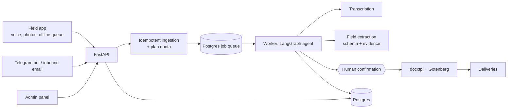

# ReportAI

**A field technician dictates the visit; the report comes out in the company's own Word template.**

ReportAI turns a voice note, typed notes and photos into a finished report: the company's own
`.docx` template, filled in and sent as a PDF once the technician has checked what was understood.
It is built for occupational health and safety visits and inspections, where the report is a
legal record and a wrong date or an invented measure is a real failure, not a style nitpick.

- **Try it:** record a visit in the browser at [reportai.vazquezlabs.com](https://reportai.vazquezlabs.com).
- **How it's built:** the engineering case study (architecture, agent, multi-tenancy, offline field
  app, evals and the decisions behind them) is at
  [reportai.vazquezlabs.com/architecture](https://reportai.vazquezlabs.com/architecture).

## What happens to a voice note

1. **Capture.** The technician opens the field app (an installable web app), picks the report
   type, records and adds photos. Without coverage the recording waits on the phone and goes up
   when the network is back.
2. **Understand.** The audio is transcribed and a model fills the report's fields from the
   company's own field definitions, quoting the words each value came from. A required field the
   note doesn't cover is flagged, not guessed.
3. **Confirm.** The technician reviews the form and the PDF preview, corrects by voice or by
   typing, and confirms. Nothing is sent before that.
4. **Deliver.** The fields go into the company's template and the PDF reaches the inboxes set for
   that report type. Every copy is tracked and can be sent again.

A company's own Telegram bot and inbound email are optional extra ways in; WhatsApp is
experimental.

## How it works



Each company defines its own report types, fields, template and recipients in the admin panel:
a new report type is configuration, not a code change.

## Engineering highlights

- **Durable by design.** Ingestion is idempotent; work goes through a Postgres job queue
  (`SKIP LOCKED`, lease and heartbeat) to a separate worker. The agent's state is checkpointed in
  Postgres, so a retry resumes where it stopped and a report waiting for confirmation survives a
  restart.
- **Extraction you can check.** The field schema belongs to each company and becomes a Pydantic
  model at run time; the model answers with structured output and a quote per field. A golden set
  gates accuracy at 90 % with zero invented values.
- **Multi-tenant by construction.** The company always comes from the signed-in user, another
  company's record answers 404, and a test walks every route with an id using another company's
  token.
- **A field app that works with one bar of signal.** Hand-written service worker, an IndexedDB
  queue tied to the session's user, sign-in by magic link or code, and a Content Security Policy
  with a per-response nonce.
- **One codebase, two run modes.** A hosted multi-tenant service, or one company per server with a
  one-line installer, a setup wizard, encrypted settings and `reportai update`.
- **Guardrails for running it.** Per-plan quotas, a daily AI spend breaker, an audit log, data
  export, account deletion with a grace period and audio retention.

## Install it on your own server

One installation serves one company, on its own server, with its own AI provider account:

```sh
curl -fsSL https://raw.githubusercontent.com/avaazquezz/ReportAI/main/infra/install/install.sh | sudo bash
```

Then open the address it prints and follow the setup wizard. See
[`docs/install.md`](docs/install.md) and [`docs/maintenance.md`](docs/maintenance.md): keeping an
installation updated (`reportai update`) is the job of whoever maintains it.

## Develop

The dev stack runs in Docker (`cp .env.example .env`, then `make up` and `make migrate`); `make
test` and `make lint` run the checks. See [`docs/local-development.md`](docs/local-development.md)
and [`CLAUDE.md`](CLAUDE.md) for the full set of commands and the project's invariants.

## Status

What has been built, what is next and why each decision was taken:
[`PROJECT_ROADMAP.md`](./PROJECT_ROADMAP.md).

## Tech stack

- **Backend:** Python, FastAPI, SQLAlchemy 2 (async), Alembic, Postgres 16
- **Agent:** LangGraph with the Postgres checkpointer
- **AI:** Anthropic Claude or any OpenAI-compatible model for extraction; Whisper-compatible
  transcription (Groq by default)
- **Documents:** docxtpl and Gotenberg
- **Panel and field app:** Nuxt 4, Vue 3, Vuetify 4, Pinia, i18n (Spanish and English)
- **Infra:** Docker Compose; Caddy with automatic HTTPS on a company's own server, Traefik on the
  hosted service; GitHub Actions for CI and the published images

## License

[Sustainable Use License 1.0](LICENSE): free to self-host for your own internal use.
