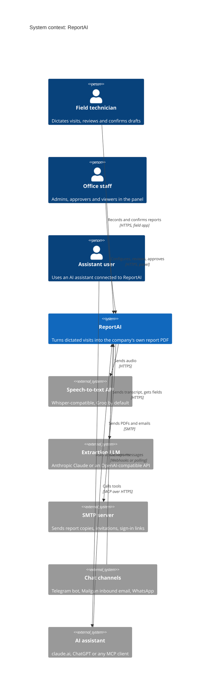
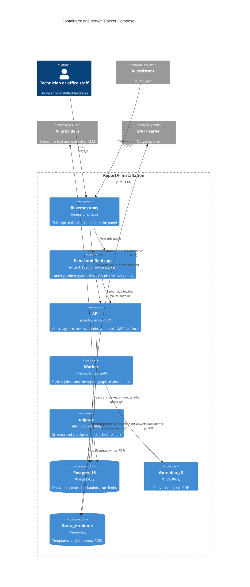
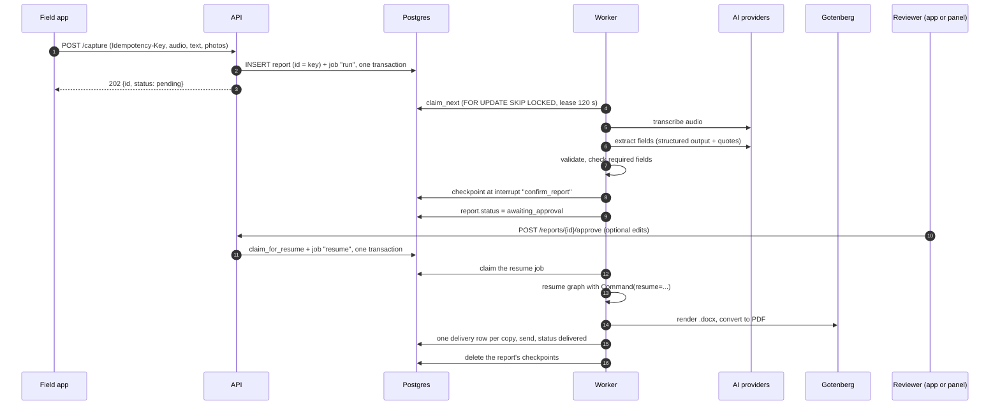
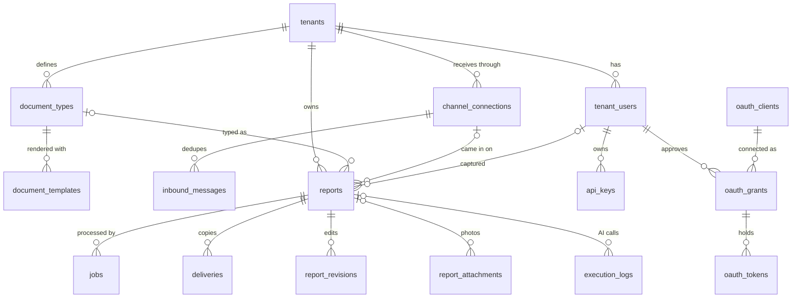

# Architecture

This page is for an engineer who has never seen ReportAI and needs to know what runs, how one
report travels through it, and which rules the code relies on. For the reasons behind each choice,
see the [decision records](decisions/README.md); for the mechanism of each subsystem, the
[how-it-works pages](#how-it-works-pages).

## What the system does

A field technician dictates a visit (or types it, with photos). ReportAI transcribes the audio,
extracts the fields of the company's own report type with an LLM, shows the result for a person to
confirm or correct, then fills the company's Word template, converts it to PDF and delivers it. The
document is a formal record (occupational health and safety visits and inspections), so two rules
shape everything: nothing is sent without a human confirming it, and a value the dictation did not
contain stays empty instead of being guessed.

One codebase runs in two modes, chosen by `SINGLE_TENANT` (`backend/app/core/config.py`):

| Mode | `SINGLE_TENANT` | Who runs it | Set up by |
|---|---|---|---|
| Hosted, multi-tenant | `false` (default) | One service for several companies, under a super admin | The super admin creates companies; self-signup exists behind `SIGNUP_ENABLED` (off) |
| Self-host | `true` | One company per server | `infra/install/install.sh` and the panel's setup wizard ([install guide](install.md)) |

## System context

Only four outside services receive report content: the speech-to-text API (audio), the extraction
LLM (transcript), the SMTP server (the PDF and its recipients) and, when a report came in through a
chat, that chat. Each company can bring its own keys for the first two (see
[AI providers](how-it-works/ai-providers.md)).

## Containers

The self-host compose is `infra/install/docker-compose.yml` (Caddy, `infra/install/Caddyfile`);
the hosted compose is `infra/docker-compose.prod.yml` (behind an external Traefik); development is
`infra/docker-compose.yml` (adds Mailpit, runs the frontend with `npm run dev`).

## Components and why each exists in this form

| Component | Responsibility | Why this form |
|---|---|---|
| **API** (`backend/app/main.py`) | Every HTTP route: sign-in, capture, review, admin, webhooks, the MCP endpoint. Never runs the agent. | Webhooks and the field app must get an answer in milliseconds; anything slow is handed to the worker as a job in the same transaction. The image runs two uvicorn workers (`backend/Dockerfile`), so nothing per-request may live in process memory (the MCP server is stateless for this reason). |
| **Worker** (`backend/app/worker.py`) | Claims jobs from Postgres and runs or resumes a report's LangGraph graph; every 10 minutes runs maintenance (retention, expired pauses, pruning); polls Telegram when there is no public address. | A deploy or crash of the API never loses a report, and a crash of the worker only delays one: its lease runs out and the job is claimed again. See [job queue and checkpoints](how-it-works/job-queue-and-checkpoints.md). |
| **Postgres** | The data, the job queue (`jobs`), LangGraph checkpoints, the rate limiter (`rate_limit_hits`), encrypted settings. | One stateful service to run and back up on a company's own server: no Redis, no broker ([ADR 0003](decisions/0003-postgres-job-queue.md)). |
| **LangGraph graph** (`backend/app/services/agent/graph.py`) | 25 nodes: ingest, transcribe, pick the report type, extract, validate, ask for missing fields, wait for approval, render, deliver. | Every pause for a person is an `interrupt()` saved by the Postgres checkpointer, so a report can wait days and survive restarts ([ADR 0004](decisions/0004-langgraph-checkpointer-human-approval.md)). |
| **Gotenberg** | `.docx` → PDF with LibreOffice, inside the server. | Confidential documents never go to a third-party conversion API ([ADR 0006](decisions/0006-docxtpl-gotenberg-rendering.md)). |
| **Panel and field app** (`frontend/`) | The landing, the admin panel, and the installable field app with its offline capture queue; relays the OAuth discovery documents from the API. | One build and one origin: the API lives under `/api` on the same domain, so production needs no CORS and session cookies can be `SameSite=Strict`. See [field app offline](how-it-works/field-app-offline.md). |
| **migrate** | `alembic upgrade head && python scripts/setup_checkpointer.py`, then exits. | LangGraph's `setup()` races when two processes run it on a fresh database (`backend/app/core/langgraph_checkpointer.py`, `setup_checkpointer_schema`); one one-shot process avoids it, and the API and worker refuse to start without the checkpoint tables. |
| **Reverse proxy** | TLS and routing: `/api/*` to the API with the prefix stripped (`API_ROOT_PATH=/api`), the rest to the panel. | Caddy gets certificates on its own on a company's server; the hosted service shares an existing Traefik. |
| **MCP server** (`backend/app/mcp_server/`) | Tools for AI assistants: list document types, search and read reports, fetch a PDF, start a draft. | A plain route inside the API, acting as the caller's person through the panel's own checks. See [MCP server and OAuth](how-it-works/mcp-and-oauth.md). |

## One report, end to end

The field app is the primary channel. A chat message (Telegram, email, WhatsApp) enters the same
pipeline through `ingest_message` (`backend/app/services/agent/ingestion.py`) instead of
`POST /capture`; the differences are listed after the diagram.

Step by step:

1. **Capture.** The app makes a UUID before the first upload and sends it as `Idempotency-Key`;
   it becomes the report's id, so a retry returns the same report (`backend/app/api/capture.py`,
   `capture_report`). The API checks the plan and wallet (`plans.message_refusal`,
   `plans.new_report_refusal`), validates every photo before storing anything, saves the audio in
   `inbound_tmp`, and calls `create_report_with_job`, which inserts the report and its `run` job in
   the caller's transaction.
2. **Claim.** The worker's loop calls `claim_next` (`backend/app/services/jobs/queue.py`), which
   never hands out two jobs of one report at once, then `process` in
   `backend/app/services/jobs/runner.py` renews the lease every 40 seconds.
3. **Run the graph.** `_run` builds an `AgentState` (`backend/app/services/agent/state.py`) with
   `thread_id = str(report_id)` and invokes the compiled graph. Nodes write progress onto the
   report row as they go (`save_report`), so the panel never reads a checkpoint.
4. **Pause.** At `await_human_approval` the graph calls `interrupt({"kind": "confirm_report"})`.
   `ainvoke` returns with `__interrupt__`; `_mark_paused_if_interrupted` maps the kind to a status
   (`awaiting_approval`, `awaiting_details` or `awaiting_doctype_selection`).
5. **Review.** In the app the form is the question: missing required fields are highlighted
   instead of asked in chat (`_route_after_completeness` skips the chat question for `web`). The
   reviewer approves with edits (`POST /reports/{id}/approve`, which refuses while a required field
   is empty), sends a spoken or typed correction (`POST /reports/{id}/reply`), or rejects
   (`POST /reports/{id}/reject`, approvers only) — all in `backend/app/api/admin/reports.py`.
6. **Resume.** `request_resume` flips the report from a pending status to `pending` with a
   conditional `UPDATE` and enqueues a `resume` job in the same transaction, so two clicks or two
   duplicate replies resume it once. The worker resumes with `Command(resume=reply)`.
7. **Render and deliver.** `render` fills the template with docxtpl in a sandboxed Jinja
   environment (`backend/app/services/rendering/docx_render.py`), `convert_pdf` calls Gotenberg,
   `deliver` writes one `deliveries` row per copy and sends them; a copy that fails gets its own
   `deliver` job (`backend/app/services/delivery/deliveries.py`). `finalize_report` sets
   `delivered` or `delivery_failed`.
8. **Clean up.** After any job that leaves the report in a terminal status, the runner deletes the
   report's checkpoint thread (`_forget_finished_thread`).

What differs for a chat channel:

- **Idempotency** comes from the channel's own message id: `inbound_messages` has a unique
  `(connection_id, external_id)` and a redelivered webhook answers `duplicate`.
- **One report in flight per sender.** The partial unique index `uq_reports_one_active_per_sender`
  (`backend/app/models/report.py`) makes the sender's next message a reply to the paused report,
  not a new one. The app (`web`) is excluded, so a technician can keep several drafts open.
- **Questions in the chat.** An unknown report type and missing required fields are asked on the
  channel, with interrupts of their own; replies are classified as confirm, correct, cancel or a
  new report (`backend/app/services/agent/tools/intent.py`: rules for short replies, the model
  for long ones, "correct" when unsure).
- **Allowed senders.** A connection with an empty `allowed_senders` list refuses everyone unless
  `ALLOW_ANY_SENDER=true`, so a stranger who finds a bot can't spend the company's AI credit.

The full graph, its loops and the status of every pause are in
[report lifecycle](how-it-works/lifecycle.md).

## Data model

Every company-owned table carries `tenant_id` with `ON DELETE CASCADE` to `tenants`, so purging a
company (`backend/app/services/data_lifecycle.py`, `purge_tenant`) deletes its rows in one
statement after its files and checkpoints are gone.

The tables and the constraints the code depends on:

| Table | Holds | Key constraints |
|---|---|---|
| `tenants` | One company: language, time zone, branding, plan, `platform_ai`, pending deletion | `slug` unique |
| `tenant_users` | Panel and field-app accounts; `role`, `token_version` | `email` unique; check `role = 'super_admin' OR tenant_id IS NOT NULL` |
| `document_types` | A report type: `field_schema` (JSON, not JSONB, to keep field order), prompt instructions, recipients | unique `(tenant_id, name)` |
| `document_templates` | The `.docx` behind a type | FK to `document_types` cascade |
| `channel_connections` | A way in (web, Telegram, email, WhatsApp); encrypted `credentials`; `allowed_senders` | unique `(channel_type, routing_key)` (one `web` connection per company) |
| `inbound_messages` | Ids of messages already ingested | unique `(connection_id, external_id)`; pruned after 30 days |
| `reports` | Status, transcript, fields, evidence, file paths, requester | partial unique `uq_reports_one_active_per_sender`; `document_type_id` and `channel_connection_id` `SET NULL` so history survives |
| `report_revisions`, `report_attachments` | Every edit, approval, rejection; photos | `report_attachments.report_id` nullable: a photo sent before its voice note waits up to 60 minutes |
| `jobs` | The work queue | index `(status, run_after)`; FK to `reports` cascade |
| `deliveries` | One row per copy of a finished report | unique `(report_id, kind, destination)`: planning twice never duplicates a copy |
| `execution_logs` | One row per graph node run: tokens, audio seconds, cost, latency, `platform_key` | partial index on `created_at WHERE platform_key` for the platform's spend breaker |
| `audit_events` | Who did what in the panel | pruned after 365 days |
| `password_reset_tokens`, `used_refresh_tokens`, `sender_invites` | Single-use links and codes (hashes only), spent refresh-token ids, chat invitations | hashes unique |
| `api_keys` | Personal keys for the MCP server (hash, prefix, expiry, revocation) | `key_hash` unique |
| `oauth_clients`, `oauth_codes`, `oauth_grants`, `oauth_tokens`, `oauth_metadata_fetch_failures` | The OAuth authorization server's state | `oauth_clients.kind IN ('dcr','cimd')`; codes and tokens keyed by their hash |
| `instance_settings`, `company_settings` | Settings entered in the panel (installation-wide, or a company's own AI keys); secrets encrypted | primary key `key` / `(tenant_id, key)` |
| `rate_limit_hits` | The Postgres-backed sliding-window limiter | index `(key, at)`; pruned after a day |
| LangGraph's `checkpoint*` tables | The paused state of each report, keyed by `thread_id = report id` | created by `setup_checkpointer.py`, not Alembic |

Secrets stored in the database (channel tokens, AI and SMTP keys, OAuth client secrets) are
encrypted with Fernet under a key derived by HKDF from `ENCRYPTION_KEY`, or from `SECRET_KEY` when
`ENCRYPTION_KEY` is empty (`backend/app/core/crypto.py`). Changing that key makes them unreadable,
and `decrypt` fails loud with `UndecryptableSecretError` instead of returning nothing.

## Invariants

These are the rules the code relies on. Breaking one is a bug even if every test passes.

### Tenant isolation

- Every company-scoped route takes the company from the authenticated user with
  `require_tenant_id` and loads rows by id with `get_scoped_or_404`
  (`backend/app/core/scoping.py`). A company id never comes from the request body or query.
- Another company's row answers **404, never 403**: a 403 would confirm that the id exists.
- A technician sees only their own reports: `visible_report` and `own_reports_only`
  (`backend/app/api/admin/reports.py`) answer 404 for a colleague's, and the MCP server calls the
  same functions.
- `backend/tests/test_tenant_isolation.py` calls every route that takes an id with company A's ids
  as company B's users and expects 404; a guard test fails when a route with an id exists that the
  matrix does not classify. Every new route with a path id goes into it.
- Postgres row-level security is deliberately not used yet ([ADR 0005](decisions/0005-tenant-isolation-in-code.md)).

### Self-host must not change

New feature flags default to off, and new columns get neutral defaults, so a `SINGLE_TENANT=true`
installation behaves exactly as before an upgrade. Examples in the code: `MCP_OAUTH_ENABLED=false`,
`AUDIO_RETENTION_DAYS=0` (keep forever), `tenants.plan` defaulting to `unlimited`, and
`company_ai.uses_own_keys` returning false on a single-tenant server.

### One transaction for a report and its job

A report and the job that processes it are created together (`create_report_with_job`), and a
resume is claimed and enqueued together (`request_resume`). A report therefore never exists without
something that will process it, and a paused report is never resumed twice.

### Writes are committed before the response

Routes declare `Depends(get_db, scope="function")`, so the commit runs before the response is
sent. See [database sessions](how-it-works/database-sessions.md).

### Human confirmation before anything is sent

No path renders or delivers a report without passing through `await_human_approval` and a
`confirm` intent. The MCP server can start drafts but never approve or send them.

### i18n

Every message a person sees from the backend goes through `t()` in
`backend/app/services/i18n.py`, in `es` and `en` (`SUPPORTED_LANGUAGES`);
`backend/tests/test_i18n.py` checks that both languages have the same keys and placeholders. Panel
strings live in `frontend/i18n/locales/es/` and `frontend/i18n/locales/en/`.

### Errors fail loud

No `try/except` swallows an exception. The exceptions in the code are deliberate and say why:
sending a message to a person is best effort (the report must still reach its pause), and a health
probe reports a status instead of raising. A job that fails is retried or marked failed, and the
person is told (`backend/app/services/jobs/runner.py`, `give_up`).

### Secrets stay out of logs

`Settings.__repr_args__` masks every setting whose name contains `KEY`, `SECRET`, `PASSWORD`,
`TOKEN`, `DSN`, `DATABASE_URL` or `HEARTBEAT_URL` (`backend/app/core/config.py`). Telegram Bot API
URLs carry the bot token, so httpx logging is held at WARNING (`backend/app/core/logging.py`).

## How-it-works pages

- [Job queue and checkpoints](how-it-works/job-queue-and-checkpoints.md): claiming, leases,
  heartbeat, retries, resuming a graph from its checkpoint, maintenance.
- [Report lifecycle](how-it-works/lifecycle.md): every status and transition, the graph.
- [Authentication and sessions](how-it-works/auth-and-sessions.md): passwords, magic links and
  codes, refresh rotation, "sign out everywhere".
- [MCP server and OAuth](how-it-works/mcp-and-oauth.md): tools, API keys, the OAuth 2.1
  authorization server, client registration, consent, revocation.
- [Field app offline](how-it-works/field-app-offline.md): the IndexedDB queue and the service
  worker.
- [AI providers, own keys and spend caps](how-it-works/ai-providers.md).
- [Storage and retention](how-it-works/storage-and-retention.md).
- [Database sessions and commit timing](how-it-works/database-sessions.md).
- [Channel adapters](channel-adapter.md).
