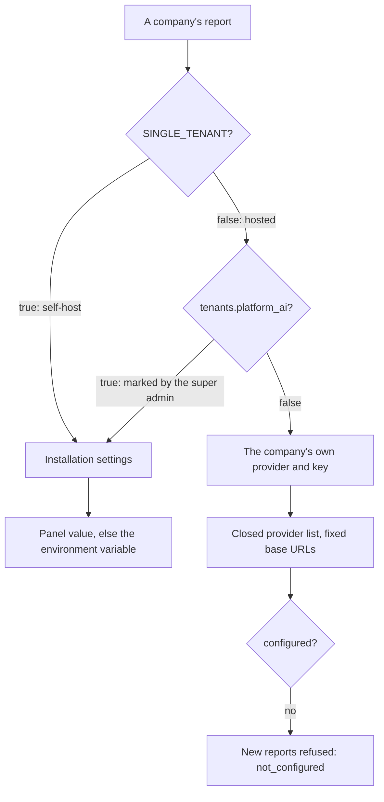

# AI providers, own keys and spend caps

Which AI a company's reports use, whose key pays for it, and what stops a runaway bill. The code is
in `backend/app/services/company_ai.py`, `backend/app/services/ai_providers.py`,
`backend/app/services/instance_settings.py`, `backend/app/services/llm.py` and
`backend/app/services/plans.py`.

## Two calls per report

| Call | API | Default | Settings |
|---|---|---|---|
| Transcription (voice notes only) | Any OpenAI-compatible `/audio/transcriptions` endpoint | Groq, `whisper-large-v3-turbo` | `TRANSCRIPTION_*` |
| Extraction, and classifying long chat replies | Anthropic Messages API, or any OpenAI-compatible chat API | Anthropic, `claude-sonnet-5` | `EXTRACTION_*`, `ANTHROPIC_API_KEY` |

Transcription sends the report's language as a hint and `temperature=0`; Whisper models are asked
for `verbose_json` so the audio duration (what they bill by) can be logged
(`backend/app/services/transcription.py`).

Extraction goes through one function, `structured_completion`, so provider differences live in one
place:

- **Anthropic**: structured outputs (`output_config` with a JSON schema), not a forced tool call,
  which newer Claude models refuse. `EXTRACTION_EFFORT` is passed as `effort` when set.
  A `refusal` or `max_tokens` stop reason is an error.
- **OpenAI-compatible**: a forced function call whose parameters are the Pydantic model's JSON
  schema. A model that doesn't call the function (some reasoning variants) is an error.
- A 401 or 403 from either becomes `ProviderRejectedKeyError`, a permanent job error: no retry
  until someone enters a working key. Clients retry twice per call and are cached per key
  (`lru_cache(maxsize=64)`), so a key changed in the panel gets a new client on the next call.

## Whose settings a company uses

`company_ai.extraction_config` and `transcription_config` decide, on every use (never cached: the
API and the worker are separate processes, and a key changed in the panel must reach the very next
report):

### Self-host: installation settings

The setup wizard and *Settings → AI and voice* store the provider, model, key and base URL in
`instance_settings`, secrets encrypted. A value saved in the panel wins over the environment
variable of the same name (`ai_from`, `transcription_from`, `smtp_from`), so an installation set up
before the panel existed keeps working from its `.env`. The base URL is free: whoever types it owns
the server.

### Hosted service: each company's own key

A company on the hosted service enters its own provider, model and key (*Settings*, routes in
`backend/app/api/admin/company_ai.py`, stored in `company_settings`). It chooses from a **closed
list** with fixed addresses (`EXTRACTION_PROVIDERS` and `TRANSCRIPTION_PROVIDERS` in
`backend/app/services/ai_providers.py`):

| List | Providers | Default model |
|---|---|---|
| Extraction | Anthropic Claude; OpenAI (`https://api.openai.com/v1`, `reasoning_effort="none"`) | `claude-sonnet-5`; `gpt-6.1-terra` |
| Transcription | Groq (`https://api.groq.com/openai/v1`); OpenAI | `whisper-large-v3-turbo`; `whisper-1` |

A company never types a URL: the worker would send requests, with the company's key, to whatever
address it wrote, the hosted service's private network included (SSRF). A provider joins the list
once it has passed the golden set (`validated`), see [Evaluations](../evals.md).

The platform's own key serves only companies the super admin marks with `platform_ai` (the live
demo, a company being shown the product). There is no fallback: until a company enters its own key,
it can't start reports, and nothing it does is paid by the platform. The *test* button for a key is
limited to 20 tries an hour per company (`ai_check_by_tenant`), so it can't be used to try stolen
keys in bulk.

## Cost accounting

Every graph node writes an `execution_logs` row (`observed_node`); nodes that call a provider put
their usage in `AgentState.last_tool_usage` for the wrapper to log: model, input and output tokens,
audio seconds, estimated cost and `platform_key` (whether the platform's key paid). A voice reply
to a paused report is transcribed outside the graph and logged as `transcribe_reply`.

Costs come from a static price table (`backend/app/services/agent/tools/pricing.py`): USD per
million tokens per model, and USD per hour of audio with each provider's minimum billed length. A
model missing from the table is logged with its tokens and no cost.

## What stops a runaway bill

`plans.message_refusal` runs for every message, replies included (they cost AI too), and
`plans.new_report_refusal` for a message that would start a report:

| Guard | Applies to | Setting | Counts |
|---|---|---|---|
| Platform-wide daily breaker | Companies on the platform's AI only | `DAILY_SPEND_CAP_USD` (0 = off) | Every platform-paid cost since 00:00 UTC |
| A plan's daily cap | Hosted service | `Plan.daily_spend_usd` in `PLANS` | The company's platform-paid cost since 00:00 UTC |
| A plan's monthly report quota | Hosted service | `Plan.monthly_reports` | Reports started this plan period, failed ones excluded |
| Trial end, cancelled plan | Hosted service | `tenants.plan_status`, `plan_period_end` | — |
| Voice without transcription configured | All | — | — |
| Per-sender hourly limit on new chat reports | All | `SENDER_RATE_LIMIT_PER_HOUR` (0 = off) | Reports by that sender in the last hour |
| Audio size | All | `MAX_AUDIO_BYTES` (10 MB) | Checked on upload and again before transcription |

Spend caps sum only rows with `platform_key = true` (`ExecutionLogRepository.total_cost_since`): a
company paying its own AI costs the platform nothing, so the platform's budget never stops it. On a
self-hosted server there are no plans: the company owns the server and pays its own AI.

Two start-up checks keep the guards honest:

- With `DAILY_SPEND_CAP_USD` set, the API refuses to start if `EXTRACTION_MODEL` has no price in the
  table (`require_priced_model_for_spend_cap`): an unpriced model logs no cost, so the cap would
  never trip.
- With the live demo on, `DAILY_SPEND_CAP_USD` must be above `PUBLIC_DEMO_DAILY_SPEND_USD`, since
  the demo's spend counts towards the platform's cap (`backend/app/core/config.py`).

The quota check counts and then creates, so two senders at once can overshoot by one or two (the
`ponytail:` note in `new_report_refusal`).

## Tests and evals

`backend/tests/test_company_ai.py`, `backend/tests/test_ai_providers.py`,
`backend/tests/test_plans.py`, `backend/tests/test_usage_metering.py`,
`backend/tests/test_abuse_guards.py`. Extraction quality per provider is measured by the golden-set
eval ([Evaluations](../evals.md)); the roadmap lists any model outside the validated ones as a known
risk.
