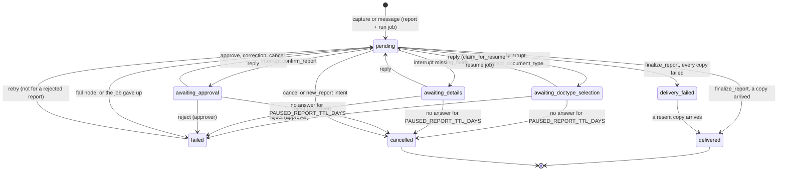
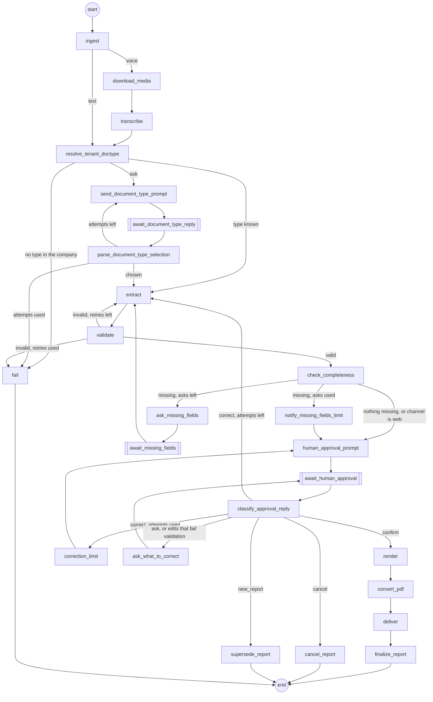

# Report lifecycle

Every status a report can be in, what moves it, and the graph that does the work. The statuses are
defined in `backend/app/repositories/report_repository.py`; the graph in
`backend/app/services/agent/graph.py`.

## Statuses

| Status | Group | Meaning |
|---|---|---|
| `pending` | active | Created, or claimed for a resume: the worker owns it |
| `awaiting_doctype_selection` | pending (waits on a person) | A chat sender must say which report type this is |
| `awaiting_details` | pending | A chat sender was asked for required fields the message lacked |
| `awaiting_approval` | pending | The draft waits for confirmation, correction or rejection |
| `delivered` | finished (terminal) | The PDF exists and at least one copy arrived |
| `delivery_failed` | finished (terminal) | The PDF exists and every copy tried so far failed; a resend can fix it |
| `failed` | terminal | The pipeline gave up, or a reviewer rejected the draft |
| `cancelled` | terminal | The person cancelled, started another report instead, or nobody answered for 14 days |

`PENDING_STATUSES` are the three `awaiting_*` statuses; `ACTIVE_STATUSES` adds `pending`, and a chat
sender can have at most one active report (the partial unique index
`uq_reports_one_active_per_sender`, `backend/app/models/report.py`). The app's `web` channel is
excluded, so a technician may keep several drafts open.

What moves a report, and where:

| Transition | Code |
|---|---|
| Create with its `run` job | `create_report_with_job`, `backend/app/services/agent/ingestion.py` |
| Pause | `_mark_paused_if_interrupted`, `backend/app/services/jobs/runner.py` |
| Resume (any reply, approval or button) | `request_resume` → `ReportRepository.claim_for_resume` |
| Approve with edits | `approve_report`, `backend/app/api/admin/reports.py` (refuses while a required field is empty) |
| Correct in the app (voice or text) | `reply_to_report`, same file |
| Reject with a reason | `reject_report`, same file: status `failed`, `reject_reason` set, the sender is told |
| Retry a failed report | `retry_report`, same file: re-enqueues the first `run` job's payload |
| Cancel after the TTL | `cancel_abandoned_reports`, `backend/app/worker.py` |
| Finish | `finalize_report_node`, `backend/app/services/agent/nodes/deliver.py` |
| Give up | `give_up`, `runner.py` → `mark_report_failed` (never overwrites a terminal status) |
| Delivered ↔ delivery failed | `send_pending` recomputes the outcome after every resend |

A delivered report stays delivered when a reviewer edits it: `PATCH /reports/{id}/fields` changes
the fields and regenerates the PDF, and records a revision, but sends nothing. Resending is a
separate action (`POST /reports/{id}/resend`).

## The graph

The graph has 25 nodes. Every node is an `async` function wrapped by `observed_node`, which applies
`NODE_TIMEOUT_SECONDS` and writes an `execution_logs` row.

Double-bordered nodes call `interrupt()`; see [job queue and checkpoints](job-queue-and-checkpoints.md)
for how a pause is saved and resumed.

### Loops and their limits

Each loop is bounded so a confused model or a long argument can't spend unlimited AI calls:

| Loop | Limit | Setting or constant |
|---|---|---|
| Ask which report type | 3 prompts | `MAX_DOCTYPE_SELECTION_ATTEMPTS` |
| Extract again after a validation error (the error is sent back to the model) | 3 consecutive failures, reset by a valid extraction | `MAX_VALIDATION_RETRIES` |
| Ask for missing required fields over chat | 2 questions, then the gaps go to the approver | `MAX_MISSING_ATTEMPTS` in `backend/app/services/agent/nodes/completeness.py` |
| Corrections | 2 re-extractions, then `correction_limit`; the report stays approvable and editable in the panel | `MAX_CORRECTION_RETRIES` |

### Extraction and evidence

`extract_node` (`backend/app/services/agent/nodes/extract.py`) builds a Pydantic model from the
document type's `field_schema` at run time (`build_result_model`,
`backend/app/services/agent/tools/extraction_schema.py`) and asks the configured model for
structured output: Anthropic's JSON-schema output format, or a forced function call on an
OpenAI-compatible API (`backend/app/services/llm.py`). The result has two parts:

- `fields`: every extractable field may come back `null`. "Required" means required to **send**,
  not "the model must produce a value": a required field left null is asked of the person, never
  invented.
- `evidence`: for each filled field, the shortest exact quote that supports it. Each quote is
  checked against the source text plus every correction; one that isn't found is stored with
  `verified: false`.

The system prompt gives the message's local date and time so relative dates resolve ("next
Thursday"), and tells the model that a message with no date leaves the date null. A company's
`prompt_instructions` are appended to it.

`validate_node` validates the fields against the same schema and normalizes them (ISO dates, plain
dicts for table rows), so what is stored and shown is exactly what the template receives.

The field types a schema can use are in `FIELD_TYPES` (`extraction_schema.py`): `str`, `int`,
`float`, `bool`, `date`, `time`, `email`, `phone`, `list[str]`, `list[int]`, `enum` (with
`options`), `list[object]` (a table, with `columns`) and `image` (a photo slot filled from the
pictures sent with the report, never by the model).

### Approval

- **In the app** (`channel_type == "web"`), confirming and cancelling are buttons; anything said or
  typed is a correction (`classify_approval_reply_node`). `POST /reports/{id}/approve` refuses while
  a required field is empty, so a spoken "yes" can't skip that check.
- **Over chat**, a reply is classified by `classify_reply`
  (`backend/app/services/agent/tools/intent.py`): short, unambiguous replies by rules ("ok", "sí",
  "cancelar"), anything longer by the model, and "correct" when unsure. A bare "no" asks what to
  change instead of re-extracting.
- **From the panel**, an approval may carry edited fields. They are validated like an extraction;
  edits that don't fit the schema send the report back to the person instead of being approved, and
  the evidence of an edited field is dropped (the quote no longer backs the value).

`human_approval_prompt_node` sends the summary on the origin channel best effort: if that send
fails, the graph still reaches the interrupt, because the extraction is already paid for and the
report stays approvable from the panel.

### Render and deliver

`render_node` fills the active template with docxtpl, sandboxed and autoescaped (templates are
uploaded by companies, so they're untrusted); a field nobody mentioned prints as nothing, not as
`None` (`backend/app/services/rendering/docx_render.py`). `convert_pdf_node` posts the `.docx` to
Gotenberg's LibreOffice route, with retries (`backend/app/services/rendering/gotenberg_client.py`).

`deliver_node` records the PDF on the report and plans one `deliveries` row per copy
(`plan_deliveries`, `backend/app/services/delivery/deliveries.py`):

- the PDF back on the origin channel, except for the app (the technician downloads it there);
- one email per address in the document type's `notification_emails`, except the sender's own
  address when the report came in by email.

`send_pending` sends every copy not yet `sent` and commits each outcome as it happens, so a crash
halfway never sends a copy twice. A failed copy doesn't fail the report: it gets a `deliver` job,
first retried after 60 seconds (`RETRY_DELAY_SECONDS`), then with the queue's backoff.

## Tests

- `backend/tests/test_graph_routing.py`: the conditional edges.
- `backend/tests/test_pause_status.py`: the status written for each interrupt.
- `backend/tests/test_report_review.py`, `backend/tests/test_reports.py`: approve, reply, reject,
  retry, edit and resend from the panel.
- `backend/tests/test_deliveries.py`: delivery planning, resends and outcome.
- `backend/tests/test_conversation_nodes.py`, `backend/tests/test_intent.py`: chat questions and
  reply classification.
- `backend/tests/eval/`: the golden-set eval of the extract → validate loop ([Evaluations](../evals.md)).
