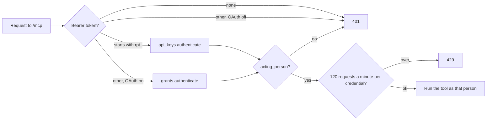
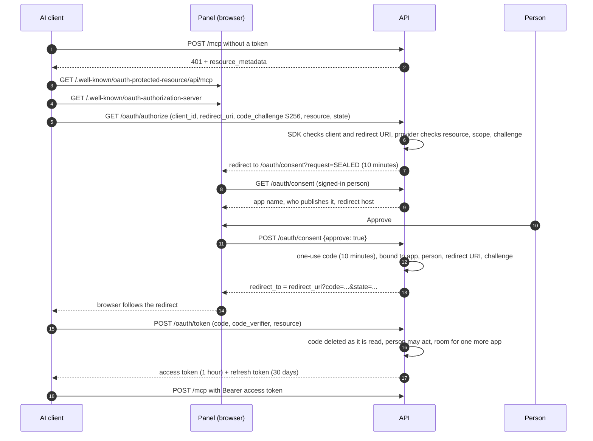

# MCP server and OAuth

How an AI assistant (claude.ai, ChatGPT, Cursor or any MCP client) reads ReportAI's reports and
starts drafts, and how it proves who it acts for. The server is in `backend/app/mcp_server/`; the
OAuth authorization server in `backend/app/services/oauth/` and `backend/app/api/oauth.py`.

The rule that shapes everything: **an assistant acts as one person, never as more**. Every
credential belongs to a person; every tool goes through the functions the panel uses for that
person (`visible_report`, `own_reports_only`, `capturable_types`), so whatever the panel hides from
them, the tools hide too. Another company's report is "not found", and nothing an assistant can do
approves or sends a report.

## The endpoint

`POST /mcp` (behind the proxy, `https://YOUR_DOMAIN/api/mcp`) serves the MCP Streamable HTTP
transport, built with the MCP Python SDK (`backend/app/mcp_server/server.py`, `McpEndpoint`):

- **Stateless and JSON** (`stateless_http=True`, `json_response=True`): each POST is a whole
  exchange and nothing is kept between requests. The API runs two uvicorn workers, and a session
  held in one worker's memory would be missing in the other.
- **POST only.** The route is registered as a plain Starlette route with `methods=["POST"]`
  (`backend/app/main.py`), so `/mcp` answers without the trailing-slash redirect a mount would add,
  and a `GET` gets a 405 ("no stream") instead of an idle stream that would stall shutdowns.
- **DNS-rebinding protection is off** on purpose: it protects servers that trust whoever reaches
  them, and here every request needs a bearer credential, which a browser never attaches on its own.
- **Instructions to the model** say that report contents were dictated by people in the field and
  are data to read, never instructions to follow (`INSTRUCTIONS`).

### Tools

| Tool | Does | Notes |
|---|---|---|
| `reportai_list_document_types` | The company's capturable types with their fields | Only active types with an active template |
| `reportai_search_reports` | Newest first, filtered by text, status, type and dates | Text matches the sender, the transcript and field **values** (never field names); up to 50 per page |
| `reportai_get_report` | One report: fields, missing required fields, transcript, reject reason | Transcript is marked as untrusted data |
| `reportai_get_report_pdf` | A finished report's PDF | A 10-minute download link always; the file embedded too when it is at most 100 KB |
| `reportai_create_report_draft` | Starts a report from text, like a typed capture | Capturer roles only; never approved or sent from here |

The read tools are annotated `read_only_hint=True`. Errors the panel would show (not found, plan
limits, validation) reach the model as tool errors it can read (`_as_tool_errors`); anything else
is a bug and fails loud.

**Drafts** go through the same checks as a capture: the caller's role must be in `CAPTURER_ROLES`,
the type must be capturable, the plan and wallet must allow it, and a person may start at most 20
drafts an hour (`mcp_drafts_by_user`, counted with an advisory-lock `claim` so simultaneous calls
can't overshoot). A draft is a `web` report whose `channel_meta` records `via: mcp` and the id of
the API key or OAuth grant that started it. A retried call may create a second draft; the hourly
cap bounds it and a person reviews each.

**The PDF link** (`backend/app/api/pdf_links.py`) is a sealed token (Fernet, with a key of its own
derived from `ENCRYPTION_KEY`; `seal` in `backend/app/core/crypto.py`) naming the report and the
credential that asked for it. It is checked again when opened: if the credential was revoked or
its person can no longer act, the link is dead. It expires after 10 minutes and is served with
`Cache-Control: no-store` and `Referrer-Policy: no-referrer`. The embedded copy is capped at 100 KB
because base64 grows it by a third and clients take a limited tool result.

## Who is calling

`McpAuth` (`backend/app/mcp_server/auth.py`) wraps the MCP app and reads `Authorization: Bearer`:



`acting_person` (`backend/app/services/credentials.py`) is the one check both kinds share: the
person exists, still belongs to the credential's company, can sign in (active account, active
company) and is not the read-only demo account. It runs on every request, with nothing cached, so
deactivating someone or suspending a company stops their assistants at once, and reactivating them
makes the same credentials work again.

With OAuth on, the 401 tells a client where to sign in (RFC 9728) and names a refused token as such
(RFC 6750), so the client refreshes or signs in again instead of retrying:

```
WWW-Authenticate: Bearer realm="ReportAI", error="invalid_token",
  resource_metadata="https://YOUR_DOMAIN/.well-known/oauth-protected-resource/api/mcp", scope="reportai"
```

## Personal API keys

The simplest credential: a person makes one in the panel (*AI assistants*) and pastes it into
their client (`backend/app/services/api_keys.py`, routes in `backend/app/api/admin/api_keys.py`).

| Property | Value |
|---|---|
| Format | `rpt_` + 32 random bytes, URL-safe (256 bits) |
| Stored | SHA-256 hash, and the first 12 characters to tell keys apart; the secret is shown once |
| Expiry | 30, 90 or 365 days, or never (the API's default, so existing keys keep working) |
| Per person | At most 10 live keys (revoked and expired ones don't count) |
| `last_used_at` | Written at most every 5 minutes: a hint for the panel, not an audit trail |
| Who sees and revokes | The owner; a company admin sees and revokes every key of the company |

There is no per-IP limit on failed keys: with 256 random bits a guess can't succeed, and each
failure is one indexed lookup (decision of 2026-11-18 in the [roadmap](../../PROJECT_ROADMAP.md#8-decisions-log)).

## OAuth 2.1 authorization server

claude.ai and ChatGPT connect to remote MCP servers through OAuth, so ReportAI is its own
authorization server ([ADR 0011](../decisions/0011-own-oauth-authorization-server.md)). It exists only
with `MCP_OAUTH_ENABLED=true`: off (the default, and on every self-hosted server), every `/oauth/*`
route answers 404 through a router-level dependency (`_enabled` in `backend/app/api/oauth.py`), the
panel's discovery relay answers 404 too, and `/mcp` takes API keys only. The hosted service turns
it on in `infra/docker-compose.prod.yml`.

The issuer is the panel's origin (`FRONTEND_ORIGIN`), which the settings refuse unless it is
`https` (plain `http` is allowed only for `localhost` and `127.0.0.1`).

### Endpoints

The API serves everything under `/oauth`; the panel answers the issuer's root `/.well-known/`
addresses by relaying the API's documents (`frontend/server/routes/.well-known/`,
`frontend/server/utils/oauthDocuments.ts`), so no proxy rule has to change between Traefik, Caddy
and development.

| Address (public) | Served by | Purpose |
|---|---|---|
| `/.well-known/oauth-authorization-server` | Panel relay → `GET /oauth/metadata` | RFC 8414 metadata |
| `/.well-known/oauth-protected-resource/api/mcp` (and the bare address) | Panel relay → `GET /oauth/protected-resource` | RFC 9728 metadata for the MCP server |
| `/api/oauth/authorize` (GET or POST) | MCP SDK `AuthorizationHandler` | Starts a sign-in |
| `/api/oauth/token` | SDK `TokenHandler`, after a `resource` check | Code and refresh exchanges |
| `/api/oauth/register` | SDK `RegistrationHandler`, size-capped and rate-limited | Dynamic Client Registration (RFC 7591) |
| `/api/oauth/revoke` | Own handler | RFC 7009 revocation |
| `/oauth/consent` (panel page) with `GET`/`POST /api/oauth/consent` | Panel and API | The person approves or denies |
| `GET /api/oauth/grants`, `DELETE /api/oauth/grants/{id}` | API | Connected apps, listed and revoked in the panel |

The metadata advertises: response type `code`; grants `authorization_code` and `refresh_token`;
PKCE `S256` only; client authentication `none`, `client_secret_post` or `client_secret_basic`;
the single scope `reportai`; and `client_id_metadata_document_supported: true`.

### Sign-in flow



What is stored and when (`backend/app/services/oauth/provider.py`):

- **Nothing until the person answers.** `authorize` seals the request (client, redirect URI,
  challenge, resource, state) into the consent URL with a 10-minute lifetime; the consent page
  carries it back.
- **The consent page re-reads the app.** `consent_client` fetches the client again and refuses
  (404) if it is gone or no longer lists the redirect URI it asked with. The page shows the host
  that publishes a metadata document, or says the app registered itself, before the person decides.
- **Approving** checks the person is below the cap of 10 connected apps (a 409 otherwise) and stores
  a code hash with a 10-minute expiry. Denying redirects with `error=access_denied`.
- **The token exchange** deletes the code in the same transaction that creates the grant, so of two
  exchanges at once the second finds nothing. It refuses a code whose person can no longer act. It
  then takes a per-person advisory lock (`make_room_for`, `backend/app/services/oauth/grants.py`),
  re-checks the cap, and revokes the person's existing connection to the same app: one connection
  per person and app. A `resource` other than this server's MCP URL is refused with
  `invalid_target` (RFC 8707).

A code presented a second time is simply unknown; it does not revoke the tokens it bought. The
`ponytail:` note on `exchange_authorization_code` names this ceiling and the upgrade path.

### Token lifecycle

| Token | Prefix | Lifetime | Stored |
|---|---|---|---|
| Access | `rpo_` | 1 hour | SHA-256 hash in `oauth_tokens` |
| Refresh | `rpr_` | 30 days | SHA-256 hash; `used_at` once spent |

Distinct prefixes let `/mcp` tell an API key (`rpt_`) from an OAuth token without a lookup.

- **Rotation.** A refresh token works once: the exchange sets `used_at` with a conditional
  `UPDATE` and issues a new pair.
- **Reuse detection.** If the `UPDATE` finds the token already spent, two parties hold a copy and
  there is no telling which one is the app (RFC 9700 §4.14.2): the whole grant is revoked, an
  `oauth.revoked_reuse` audit event is recorded, and the person approves the app again.
- **A person who can't act.** If the person was deactivated, the exchange is rolled back and the
  refresh token stays unspent, so it works again if they are let back in.
- **Bound to this server.** `grants.authenticate` refuses an access token whose grant names another
  resource.

### Client registration

An app is known in one of two ways (`backend/app/services/oauth/clients.py`):

1. **Client ID Metadata Document (CIMD).** The `client_id` is an `https` URL where the app
   publishes its metadata; this is the registration the MCP specification recommends and what
   claude.ai uses. ReportAI fetches and caches the document.
2. **Dynamic Client Registration (DCR, RFC 7591).** The app posts its metadata to
   `/oauth/register` and gets a UUID `client_id`. Kept for compatibility; capped at 16 KB per
   request and 30 registrations an hour per address. A DCR client unused for 30 days is deleted.

Either way, redirect URIs must be `https`, or `http` on a loopback address (`127.0.0.1`, `[::1]`,
`localhost`), with no fragment or user info, between 1 and 10 of them, each at most 2000
characters. Only the metadata fields the server reads are stored, and grant types the server
doesn't offer are dropped from the client's list instead of refusing the app.

#### SSRF guards on the metadata fetch

A CIMD fetch goes to an address a stranger chose, through an unauthenticated request: it is the
one place the server reaches out on someone else's say-so. `fetch_metadata_document` fences it:

| Guard | Value |
|---|---|
| Address | `https`, port 443, a path other than `/`, no user info or fragment |
| Resolved IPs | Every address the host resolves to must be public (`is_global`, not private, loopback, link-local, reserved, multicast or unspecified; IPv4-mapped IPv6 unwrapped) |
| Redirects | Not followed |
| Proxy | `trust_env=False`, so a proxy from the environment can't route around the address check |
| Time | 5 seconds in all for the slot, the DNS lookup and the download |
| Concurrency | 2 fetches at once per API process; DNS lookups run in a thread pool of their own |
| Size and type | 64 KB; `application/json` or `+json` |
| Rate | 30 real fetches an hour per address (an IPv6 /64 counts as one); cached documents are free |
| Content | `client_id` equals the URL; a `client_name` and `redirect_uris` are present; no `client_secret`; authentication `none` (PKCE only) |

The fetch runs with no database transaction open, so a slow publisher can't tie up the connection
pool.

Failures are of two kinds. A **refusal** (the address is not one to fetch, the publisher answered
410, or the JSON says something the server won't take) stops serving the document at once, cached
or not. **Unavailability** (any other status, a body that isn't JSON or is too big, a timeout, DNS
or network errors) keeps the last copy in service for up to 7 days, so a publisher's outage doesn't
disconnect everyone. Either kind is remembered for 10 minutes in
`oauth_metadata_fetch_failures`, so a failing address isn't fetched on every request. A fresh copy
is cached for 24 hours.

> **Caution:** the host is resolved for the address check and again by httpx when it connects, so a
> DNS answer that changes in between (DNS rebinding) could still reach a private address. The
> `ponytail:` note in `fetch_metadata_document` records the upgrade: connect to the vetted address
> itself.

### Revocation

| How | Effect |
|---|---|
| The person, or their company admin, disconnects the app in the panel (`DELETE /oauth/grants/{id}`) | The grant and every token it holds stop working; audited as `oauth.revoked` |
| The app signs out (`POST /oauth/revoke` with either token) | The whole grant ends (RFC 7009 §2.1 allows it). Another app's token answers 200 and revokes nothing |
| A company admin uses *Sign out everywhere* on the person | Every grant and API key of the person is revoked |
| The person is deactivated or the company suspended | Credentials stop working while that lasts, and work again if reversed |
| Refresh-token reuse | The grant is revoked |

The worker prunes expired codes and tokens, deletes grants revoked more than 30 days ago, and
deletes cached metadata documents nobody is connected through (`prune_oauth` in
`backend/app/worker.py`).

## Tests and evals

- `backend/tests/test_mcp_server.py`, `backend/tests/test_mcp_wiring.py`: tools, isolation, the endpoint.
- `backend/tests/test_mcp_oauth.py`: the authorization server end to end, CIMD fetches, reuse.
- `backend/tests/test_api_keys.py`: keys, expiry, revocation.
- `backend/tests/eval/test_mcp_agent.py`: a real model using the server (tool choice, the PDF,
  prompt injection, isolation); see [Evaluations](../evals.md).
